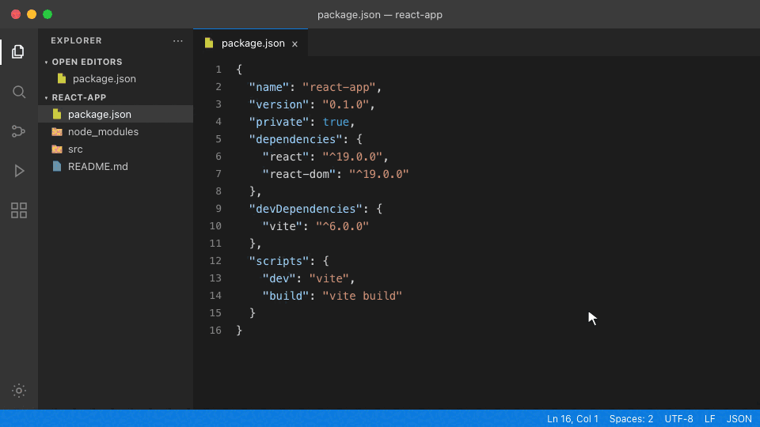

# npm-dependency-links

Links the dependencies in your package.json to their npmjs.com profile.

## Features

Visit the npmjs.com profile of your dependencies by simply `CMD/Ctrl+click` on the package name in your package.json and pnpm-workspace.yaml.

## Underline

Package names are underlined all the time by default. To show the underline only while holding Command (macOS) or Ctrl, set:

`"npmDependencyLinks.underlineOnlyWithModifier": true`

Clicking while that key is held still opens the package page, and so does Go to Definition. If `editor.multiCursorModifier` is `ctrlCmd`, hold Alt instead — the same key VS Code uses for Go to Definition.

## Custom Registry URL

To change the URL, you can set the configuration value in `settings.json` as below:

`"npmDependencyLinks.registryUrlPattern": "http://myCustomRegistry/{{pkg}}/package?queryparams"`

Note that `{{pkg}}` is the only part of the pattern that will be set by this extension. E.g., If your pattern is `http://registry.mysite.com/package?name={{pkg}}?version=latest`. If you click on `npm-dependency-links`, then the resulting URL will be `http://registry.mysite.com/package?name=npm-dependency-links?version=latest`

## Attribution

Based on the original [npm-dependency-links](https://github.com/herrmannplatz/npm-dependency-links) extension by [Rene Herrmann](https://github.com/herrmannplatz).

## Requirements

Visual Studio Code > 1.85.0
